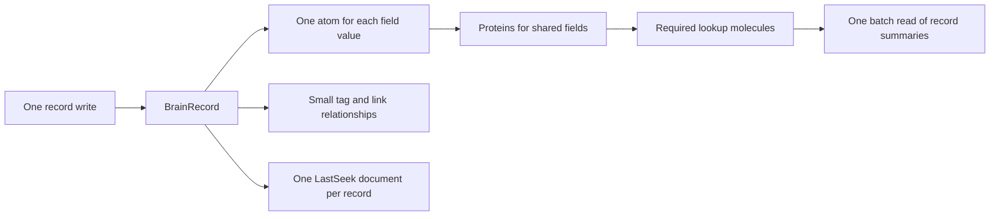

# Brain redesign for shared molecules

Proposal for Tom, 27 October 2026.

Brain should keep one record, share its field atoms across required lookup keys, and send searchable text to LastSeek once.
The app should keep tag and link relationships as small records with exact keys.
The change should remove duplicate page content, page locators, and the local keyword copy where the replacement meets the cost limits.

CAUTION: The primary reset rule remains active. Schema registration, a live conversion, an app install, and shared CI changes require Tom's approval.

## Current state

The source declares 25 schema definitions and 139 field definitions.
Ten schemas define record types. Fifteen schemas support other functions.
These are declaration counts, not live molecule, atom, or record counts.
A concept write does not also create a design, task, or reference record.

[PR 472](https://github.com/EdgeVector/brain/pull/472) already removed several record copies and moved normal writes into one mutation call.
[PR 476](https://github.com/EdgeVector/brain/pull/476) reduced a converted locator from three fields to one.
The redesign must preserve those gains.

| Current structure | Current function | Proposed treatment |
| --- | --- | --- |
| Ten record schemas | Read a record by type and slug | One record schema with an explicit type |
| BrainListPage | Lists for all records, a type, status, tag, link target, or parent | Replace only after native lookup cost checks pass |
| Two locator schemas | Find the page that contains a record | Remove with the corresponding page layout |
| BrainTypeDirectory | Find the types that use a slug | Replace with one batch of exact typed keys |
| BrainEdgeSet | Keep outbound link identities and their source | Move that source data into the canonical record |
| BrainTokenSet and keyword pages | Maintain a second keyword path beside LastSeek | Retire after LastSeek supplies the required availability |
| BrainListCount | Store counts through an app read and rewrite | Use a node aggregate only after its source update contract is proved |
| TagIndex and TagMembership | Retain earlier tag layouts and migration support | Retire after all callers use the new tag relationship |
| Body and attachment schemas | Address large text and attachment files | Keep their file function; do not replace files with large atoms |
| Snapshot and backfill schemas | Support named maintenance operations | Keep only the operations that the replacement needs |

### Duplicate work that remains

`slotsFor` selects the all-record list, the type list, and the type plus status list for a normal active record.
It adds up to two tag lists and two link-target lists.
A task can also use a parent list.
Each list card repeats the type, slug, status, update time, and a short title.
The list writer must read page heads, locate old cards, and manage page overflow.

The source also maintains up to eight keyword tokens per record.
Keyword heads hold at most 25 candidates each.
This path duplicates some search work that LastSeek also performs.
The support schemas already declare their fields as `no_index`.
They do not all request full text search.

### A correctness problem with the current page path

The page plan records an expected old value, but the normal record batch does not send that expectation.
`headToOp` removes it. `mutateBatch` sends ordinary mutations.
Two writers can read one page and then replace each other's cards.
The count path also reads a value and writes a new value without a condition in that batch.
One network call does not prevent these conflicts.

## Proposed record model

Create `BrainRecord_v2` under the existing app identity.
Keep the public record types and their status rules in the app.
Use one stable, versioned encoding of `(type, slug)` as the exact hash key.
Preserve equal slugs under different types.
Do not assume that the slug alone identifies a record.

The record contains the existing shared fields and the existing fields for tasks and decisions.
It also contains explicit link source data and the scalar fields that the selected native lookups require.
Store only fields that the record uses.
Keep long text in the existing immutable body files.
Keep attachment bytes in files.

Declare each shared field identity once through schema service.
Reuse that identity in each alternate key layout.
Use field mappers only for aliases with the same key layout.
Use proteins for different key layouts.
Do not bind unrelated record types through a common field name or a common description.

## Proposed keys and reads

Native lists should return identities, then fetch the requested summary fields in one batch.
The summary read requests title, type, slug, status, and update time.
It does not request the body or attachment files.
This adds a bounded batch read and avoids a separate title or body atom for every list member.

| Request | Proposed key | Data returned |
| --- | --- | --- |
| Get with a type | BrainRecord hash = encoded type and slug | Requested record fields |
| Get without a type | One batch of the ten possible typed hash keys | One match or an explicit ambiguity result |
| Recent records | BrainRecent hash = brain scope, range = order key | Record identities, then one summary batch |
| Records of one type | BrainByType hash = type, range = order key | Record identities, then one summary batch |
| Records of one type and status | BrainByStatus hash = encoded type and status, range = order key | Record identities, then one summary batch |
| Records with one tag | BrainTagMember hash = tag, range = order key | Record identities, then one summary batch |
| Outbound links | BrainLinkOut hash = typed source key, range = ordered link identity | Link records |
| Inbound links | BrainLinkIn hash = typed target key, range = ordered link identity | The same link atoms through another molecule |
| Child tasks | A parent relationship key | Child identities, then one summary batch |
| Search | LastSeek document identity = typed record key | Ranked identities, then one summary batch |

The order key contains a fixed-width reverse update time and a stable digest of the typed record key.
Its encoding must preserve order, delimiters, Unicode slugs, and equal timestamps.
Every update computes the key once.
A cursor carries the lookup identity, order key, and layout version.
It gives bounded continuation, not a snapshot across concurrent writes.

Each native lookup needs its own hash field and range field.
The current node requires those fields to be runtime fields.
Do not advertise a one-field native range layout that omits those fields.
The proposed list layouts also carry the shared `record_key` field.
A digest cannot recover the original typed key.
Count all three fields in the cost model.

| Native layout | Shared stored fields |
| --- | --- |
| BrainRecent | `list_scope`, `list_order`, `record_key` |
| BrainByType | `record_type`, `list_order`, `record_key` |
| BrainByStatus | `status_scope`, `list_order`, `record_key` |

The canonical record stores these scalar fields with their shared declaration identities.
`status_scope` encodes both the type and status.
These layouts store no title, body, or copied summary.

Validate each returned summary against the requested type, status, tag, or relationship.
A stale alternate key cannot supply a valid current member by itself.
Bound any refill after a rejected member and report incomplete convergence explicitly.

Do not instantiate every possible lookup.
Start with the existing required all, type, and type plus status requests.
Add another native layout only for a named request and an accepted cost.

## Write and relationship rules

1. Read the addressed record and all required relationship keys in batches.
2. Validate the complete request and calculate the complete mutation count.
3. Write immutable body files before the record when the body needs a file.
4. Send the record mutation and the tag or link changes in one bounded mutation call.
5. Let proteins update the shared atoms under the scalar lookup keys.
6. Report the record ack, disk result, lookup result, and search result separately.

A record revision protects concurrent edits to the same record.
Expose the node's per-mutation `expected` field in Brain's batch type and wire serializer.
Use an absent condition for a create and the previous revision for an update or delete.
Require the native commit to reject the related batch when that condition fails.
An older node that ignores the condition cannot support this write path.
This condition protects one node; it does not decide concurrent writes from different devices.

A protein does not remove the work for another key.
It removes the need for another copy of the field value.
The source record must retain the scalar lookup coordinates that later partial updates and deletes need.
Do not rely on temporary request fields for a later key move.

Tags and multiple links need one relationship for each member.
The current protein route selects scalar coordinates. It does not expand a tag array into arbitrary keys.
The app computes added and removed relationships from the complete record.
It writes those changes as one batch.
It never copies the title, status, or body into a tag relationship.

Preserve the current newest-first list contract.
A source update also changes the order keys of its tag, parent, and backlink relationships.
Derive the old keys from the previous record and its stored link source facts.
Include these moves in the mutation count and cost measurement, even when membership does not change.
Do not substitute a sorted sample for a globally ordered tag list.

Treat an outbound link and its inbound view as the same relationship product.
Bind their shared fields into proteins.
Keep the source type, target type when known, link kind, and source of the link.
Preserve explicit links and body links as distinct source facts.
An ambiguous target remains ambiguous until an exact typed target exists.

Do not silently retain only two tags or two inbound targets.
Reject an oversized write before the record mutation if the full change exceeds the accepted batch limit.
An error must identify the limit and the unchanged record.
Large body files can remain unreferenced after a rejected record write; the file lifecycle must handle them.

### Key moves and deletes

A status change removes the old status key and creates the new key.
A time change removes the old order key in every affected native lookup.
A title-only update must preserve every lookup membership.
A delete must remove the record's lookup keys and its outbound relationships.
A delete must preserve unrelated records and incoming references that still describe a link to a missing target.

The current core restricts automatic erasure between Hash and HashRange schemas with different field sets.
Therefore, a narrow native list cannot assume that a canonical Hash delete removes its keys.
Use explicit exact lookup erasures in the same mutation call until the node proves the required partial-view contract.
Derive those exact old keys from the source record.
Do not add a page locator to solve this problem.

## Search and counts

LastSeek owns keyword and semantic search for the canonical Brain record.
It keeps one current logical document per typed identity, with the accepted revision.
Long text can use multiple chunks under that document identity.
Only the canonical text source requests search work.
Native lookup schemas and relationship schemas declare every field as `no_index`.
Avoid duplicate documents from protein views.

A searchable long body must include the file text through an authorized file read.
The body marker or inline head cannot stand for the complete body in an exact search claim.
Search reports its accepted revision or a pending result.
An unavailable LastSeek service produces a clear unavailable result or an explicitly limited fallback during conversion.
Retire the keyword pages only after this path meets the required availability.

An exact count needs an atomic source update or a source revision that the node checks.
A protein is not a count mechanism.
Use the node's aggregate path only after duplicate retries, deletes, and concurrent creates preserve the count.
Do not count a sample page or walk every record to serve `--count`.
Retain the current count layout until the replacement meets the public count contract.

## Cost and acceptance limits

Fewer schema definitions do not prove lower disk or memory use.
For `N` records, `F` shared fields, and `V` native views, a wide native layout can require about `N × F × V` extra tips.
Proteins share the field atoms; they do not eliminate those tips.

A converted locator currently uses one field.
A full 20-card page uses three fields, or approximately 0.15 page fields per card.
One current list therefore uses approximately 1.15 fields per card before overflow and file overhead.
A native view requires at least its two key fields under the current runtime rule.
The proposed views use three fields, including `record_key`.
This calculation counts logical fields, not bytes or elapsed time.
It shows why a blanket replacement can increase disk cost.

Use narrow native views to remove shared-page conflicts and large page rewrites.
Compare their real cost with the current compact page layout before the conversion.
Keep the compact page layout if the native alternative fails the accepted cost limit.
Schema count is a diagnostic, not the acceptance metric.

Required operational checks cover:

- Record create, partial update, full update, delete, and recreation.
- Concurrent writes to different records that use the same type and status.
- Status and order changes with no old lookup result after convergence.
- Equal slugs under different types and equal timestamps under one hash.
- All stored tags and links, including more than two members.
- Long bodies, exact search phrases, attachments, and file references.
- Interrupted replies, repeated requests, restart, and recovery.
- Source and alternate tips that name the same atom for the same shared field.
- One current logical LastSeek document per canonical record, with the correct revision.
- Exact batch call count, native tip count, atom count, file bytes, memory size, and write latency.

These are product operations and operational measurements, not a new test suite.
Use CI for LastDB builds and benchmarks.
Do not run a local benchmark or a local LastDB build.
Keep raw output in CI artifacts and link the run.
Do not claim lower disk use until the retained output proves it.

## Implementation sequence

1. Add the versioned typed identity, canonical schema, field declarations, and pure key code in an isolated worktree.
2. Add the batched record reader and the narrow native lookup source paths.
3. Add exact delete cleanup and tag or link relationship writes.
4. Keep public CLI and MCP types, status rules, body files, and attachments compatible.
5. Exercise the product operations in an approved CI environment with a fresh synthetic home.
6. Compare the native layout with the current compact page layout and record the cost decision.
7. Obtain approval for schema registration and an app conversion.
8. Stop older writers before the conversion and keep old identities available during verification.
9. Convert only named typed keys or a trusted export manifest, with a durable cursor and a recoverable source.
10. Switch readers only after the named records, relationships, files, and search revisions agree.
11. Retire old writers and support layouts after the conversion succeeds.

The reset rule does not prove that every current or future home is empty.
This proposal does not authorize access to the primary or its archive.
Do not erase old schemas or files on the basis of an empty sample.

## Source references

Brain source revision: `141edeb62d35d18d20c46330e492250835e5303b`.
LastDB source revision: `fb9413ecaac46e64397b1bdf951d633b99f7a5ce`.
The findings describe source behavior. They do not describe a measured primary state.

- [Brain schema declarations](https://github.com/EdgeVector/brain/blob/141edeb62d35d18d20c46330e492250835e5303b/src/schemas.ts): record and support definitions, field identities, and search classifications.
- [Brain page plan](https://github.com/EdgeVector/brain/blob/141edeb62d35d18d20c46330e492250835e5303b/src/list-page.ts): list scopes, card copies, caps, page moves, and keyword work.
- [Brain record batch](https://github.com/EdgeVector/brain/blob/141edeb62d35d18d20c46330e492250835e5303b/src/resident-write-plan.ts): page expectation removal and count read plus rewrite.
- [Brain node client](https://github.com/EdgeVector/brain/blob/141edeb62d35d18d20c46330e492250835e5303b/src/client.ts): mutation batch wire shape and asynchronous convergence.
- [Brain search path](https://github.com/EdgeVector/brain/blob/141edeb62d35d18d20c46330e492250835e5303b/src/search-plane.ts): LastSeek and earlier search paths.
- [LastDB field coherence](https://github.com/EdgeVector/lastdb/blob/fb9413ecaac46e64397b1bdf951d633b99f7a5ce/fold_db/crates/core/src/schema/field_hash_coherence.rs): declared field identities and different key layouts.
- [LastDB protein coordinates](https://github.com/EdgeVector/lastdb/blob/fb9413ecaac46e64397b1bdf951d633b99f7a5ce/fold_db/crates/core/src/fold_db_core/mutation_manager/molecules/protein_key_fields.rs): scalar fields before and after a mutation.
- [LastDB required key fields](https://github.com/EdgeVector/lastdb/blob/fb9413ecaac46e64397b1bdf951d633b99f7a5ce/fold_db/crates/core/src/fold_db_core/mutation_manager/molecules/prepare/key_fields.rs): runtime key fields and their atoms.
- [LastDB erasure rules](https://github.com/EdgeVector/lastdb/blob/fb9413ecaac46e64397b1bdf951d633b99f7a5ce/fold_db/crates/core/src/fold_db_core/mutation_manager/cas.rs): complete-field guard for Hash and HashRange peers.
- [LastDB native batch conditions](https://github.com/EdgeVector/lastdb/blob/fb9413ecaac46e64397b1bdf951d633b99f7a5ce/fold_db/crates/core/src/fold_db_core/mutation_manager/write/native.rs): source conditions before the native commit.
